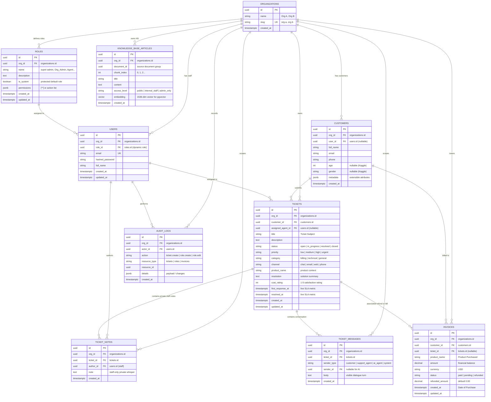

# Multi-Tenant B2B Customer Support AI — Relational Database Schema (Dynamic RBAC)

This document contains the official Entity-Relationship diagram showing the 10 core tables, dynamic RBAC via the `ROLES` table, all fields (including Kaggle support mappings), and explicit foreign key relationships with cardinality.

## Interactive Mermaid Entity-Relationship Diagram

## Vector Graphic Export

The visual vector graphic with direct entity-connector lines, cardinality indicators (`1:N`), and the new `ROLES` entity is available in [docs/er_diagram.svg](file:///home/tarun/Desktop/agentic-backend/docs/er_diagram.svg).
